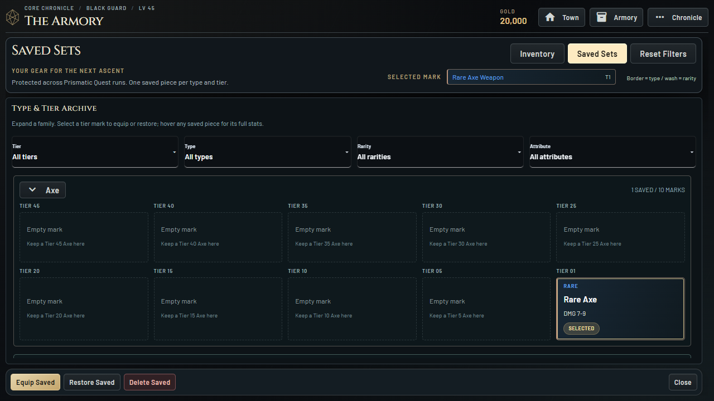
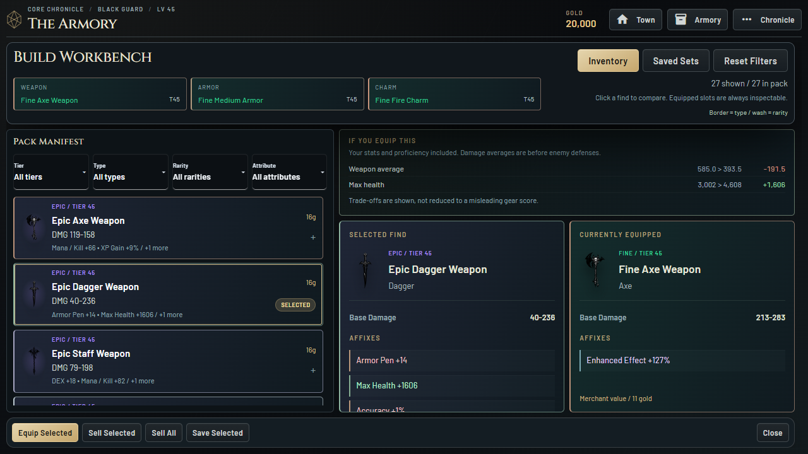
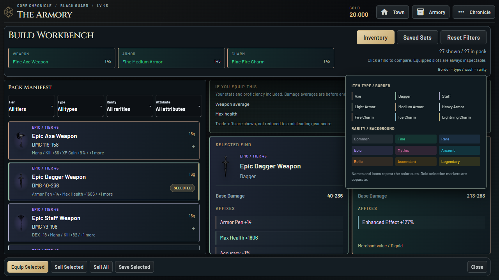
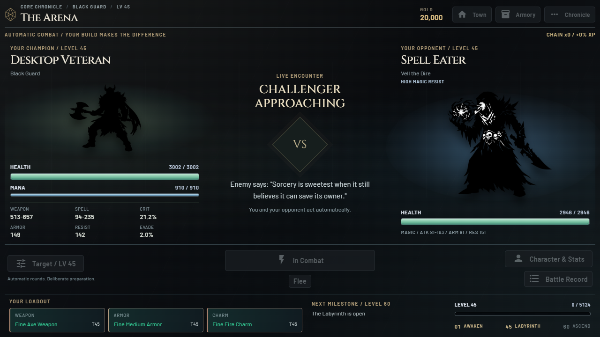

# Saved Sets and Visual Language 0.8.0

## Restore the Archive

Saved Sets once again exposes its actual storage structure: nine collapsible item
families, each with one mark for every tier. The descending tier order matches the
older archive. Empty marks are visible so players can plan future runs. Occupied
marks excluded by rarity/affix filters say "Filtered item", never "Empty mark".

The archive uses its full workspace rather than duplicating the pack/comparison
layout. Its selected-mark summary and pinned Equip/Restore/Delete actions remain
visible; full stats use the existing refresh-stable inspection portal. Collapse
preferences persist through the existing save mechanism. No item ownership or
carryover rules changed.

Selection now updates the enabled state of mounted item-action buttons rather
than rebuilding them. This avoids dropping a very fast follow-up Save/Restore
click during selection refresh, and reduces presentation churn without changing
the underlying item transactions.

## Two Independent Item Channels

- The frame/edge belongs to type: copper Axe, sage Dagger, mist-violet Staff,
  linen Light Armor, bronze Medium Armor, silver Heavy Armor, ember Fire Charm,
  glacier Ice Charm and muted-gold Lightning Charm.
- The interior wash belongs to the existing rarity palette, mixed at about 10%
  against a dark ink surface. Rarity names and item icons remain visible.
- Gold selection marks sit separately from the type border instead of replacing
  it. No pulsing or extra animation is added to item lists.
- Existing loot-reveal sheen and rarity bloom remain intact; the shared item
  palette does not override their animated shadows.
- Pack/archive cards, equipped buttons, item sheets, discoveries, vault and
  Marketplace cards use the same mapping. A native details-based visual key has
  no server handler or polling loop.

## Monster Readability

Arena auras are useful information again, rather than an always-blue backdrop.
Ordinary defenses keep a neutral halo. High armor adds silver; high magic
resistance adds blue. Both can coexist. Old species-specific blue hues are not
reused for ordinary enemies because that would falsely imply high resistance.
Classification uses actual defenses compared with the level-adjusted normal
pre-archetype baseline, with a 1.3x threshold. It does not claim immunity, change
stats or infer resistance merely from the monster's species. Text labels explain
the cue, while the exact armor/resistance figures remain visible.

## Verification and Rollback

Tests cover independent type/rarity channels, unchanged item objects, archive
ordering and filtered-versus-empty marks, armor/resistance classification at
levels 1, 45 and 80, and saved gear surviving Prismatic Quest into a level-one run.
Browser checks cover nine families/90 marks, collapsed groups, filters, selection,
hover, reload, internal layout bounds and restore/save item conservation.

The release build passed dependency validation, Ruff and all 182 regression tests.
Packaged archive tests verified independent colors across nine types, 90 tier
marks, filtered-item honesty, collapse/expand, stable action-button identities,
save/restore conservation, reload and a real high-MR encounter with a blue aura.
Packaged equipment tests also passed save/restore/equip and persistent combat
hovers. The fresh-player Rare/equip/fight and service-panel journey passed. No
JavaScript errors or external requests were observed. Native WebView2 startup and
package-integrity verification passed on the release executable.

Disposable reports: `.local-test/archive-final-report`,
`.local-test/archive-release-equipment-report` and
`.local-test/archive-release-journey-report`. Release build log:
`.local-test/archive-build-release.log`. These are short automated checks, not
a substitute for extended player-driven progression or native hardware QA.

This remains isolated on `codex/steam-experience-redesign`. Web/main and the two
earlier Steam editions are unchanged. The previous source is tagged
`steam-reimagined-v0.7.0` at `4700146`; its complete executable folder is preserved
in `.build-backups/reimagined-0.7.0-4700146/PrismQuest`.

