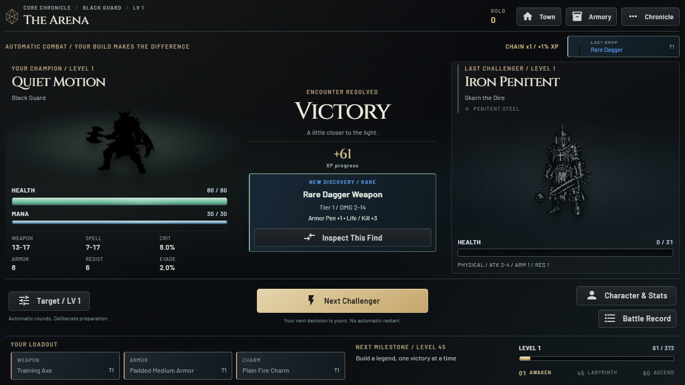
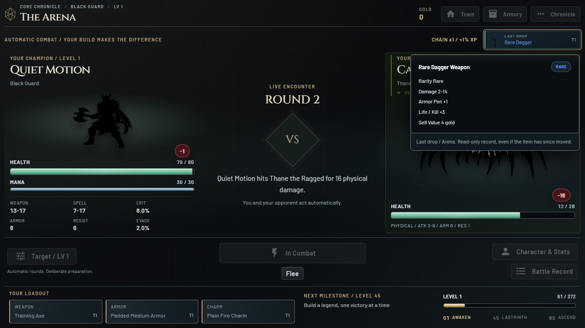
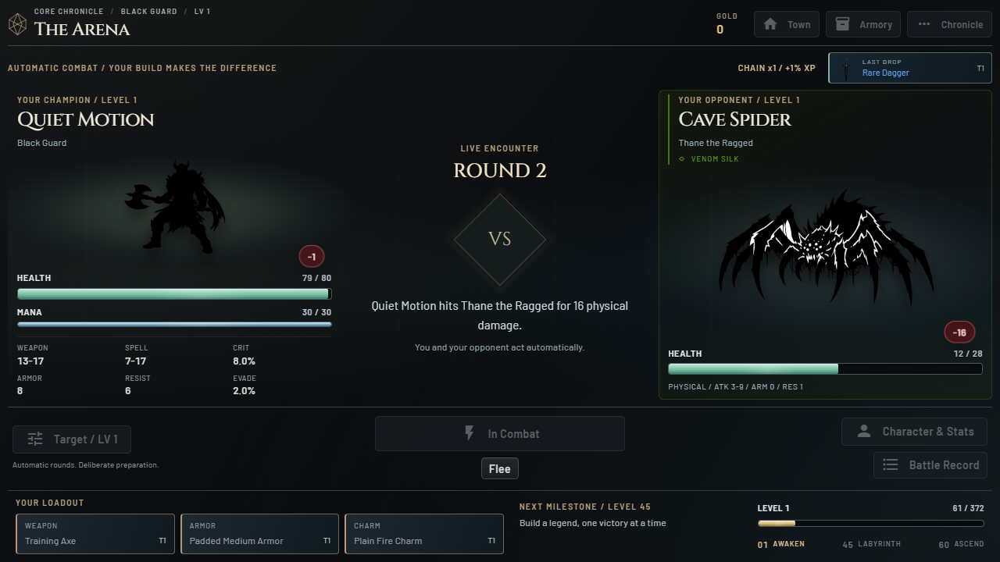

# Arena Rhythm 0.9.0

## Latest Find

One compact inspection control sits beside the chain counter, outside the battle
stage. It uses the existing last-drop snapshot rather than storing another item.
It remains enabled during combat and uses the refresh-stable inspection portal.
New drops replace it; no-drop fights leave it alone. Arena, Well and Labyrinth
sources are identified in the tooltip. Starting a different run clears the record
through the existing lifecycle. It is not advertised as a cross-restart archive.

## Rhythm Without Waiting

The new challenger settles into place over 380 ms with a brief decorative trace.
Victory/flee gently settle the defeated/retreating art; defeat dims the hero art.
Result titles resolve without a full-screen flash. Effects only animate opacity
and transforms on artwork/decorations, never HP/mana/XP bars or gameplay controls.

The event-driven client watches compact metadata on existing Arena renders. It
ignores HP, rounds and page-turn progress, and carries an elapsed animation time
across replaced DOM nodes. Starting another fight cancels the prior envelope.
No polling, extra network calls, artificial fight delay or new combat timers are
introduced. System, Desktop and game reduced-motion settings suppress effects.
Focus loss cancels the current envelope without replay on return.

The desktop Arena no longer briefly renders the previous opponent during the
legacy page-turn handoff: its art/identity is the actual current challenger from
the start. The underlying simulator and its timing remain untouched. The command
deck reserves space for Flee, so combat/result changes do not resize the stage.

## Species Atmosphere

The existing species palette colors a thin edge, faint background ink and a short
signature: Moonlit Hunt, Living Ember, Runic Bastion, Arcane Hunger and others.
Six static texture families suggest veil, ember, iron, thorn, prism or tide.
These do not animate continuously and do not claim combat effects.

Atmospheric dressing is separate from the central defense halo. Blue/silver
halos and the High Magic Resist/High Armor labels continue to use actual stats.
Species signatures explicitly identify themselves as visual flavor on hover.

## Safety and Rollback

Read-only presentation helpers have regression tests for unchanged items,
snapshot retention, escaping, consistent encounter identity across page-turn
frames and coverage of the existing monster roster. Client tests exercise real
next-fight inspection, deduplication under repeated DOM replacement, rapid
interruptions, reduced-motion suppression and focus cancellation.

The previous source is tagged `steam-reimagined-v0.8.0` at `91f3f8c`. Its complete
executable folder is in `.build-backups/reimagined-0.8.0-91f3f8c/PrismQuest`.
This update is isolated on `codex/steam-experience-redesign`; web/main and both
earlier Steam edition folders remain unchanged.

## Verification

The Windows release passed dependency validation, Ruff and all 190 regression
tests. Packaged checks verified the first Rare drop remains inspectable during
the next real fight and its round refreshes, stable stage height between results
and combat, the exact settled art scale after animation cleanup, one arrival per
challenger, and no replay on layout changes. The same-origin presentation fixture
verified elapsed-time preservation across cloned stages, rapid result-to-next
fight interruption, reduced-motion suppression and focus cancellation.

The existing packaged inventory/protected-item conservation and combat-hover
driver passed, as did the seeded service/vault/five-member Labyrinth journey.
No JavaScript errors or external requests were observed. Native WebView2 startup
and package-integrity verification passed on the release executable.

Evidence is under `.local-test/encounter-final-report`,
`.local-test/encounter-equipment-report`, `.local-test/encounter-lab-report` and
`.local-test/encounter-final-native`. Build log:
`.local-test/encounter-build-release.log`. These short automated/browser checks
do not replace extended native hardware or subjective feel/performance playtests.

