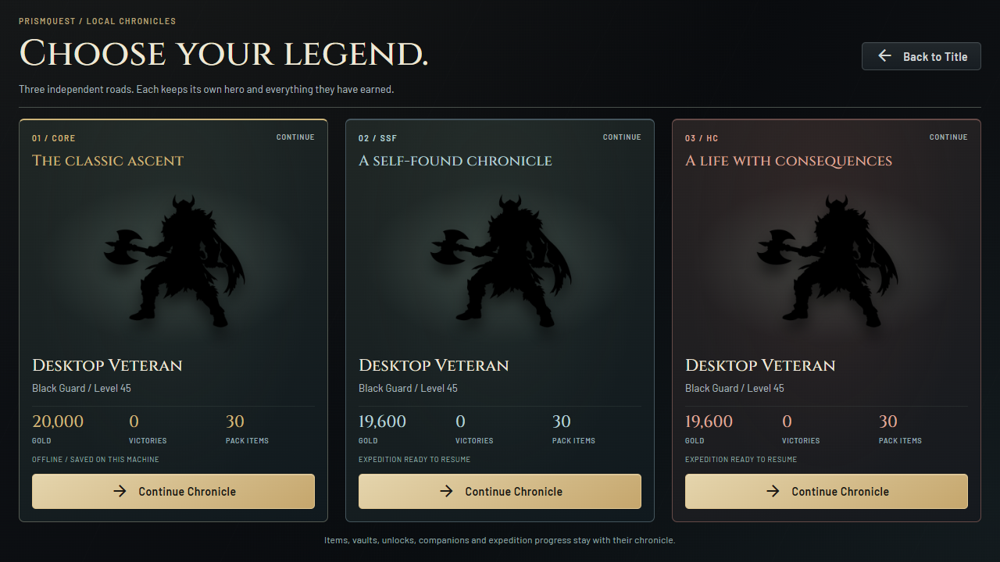
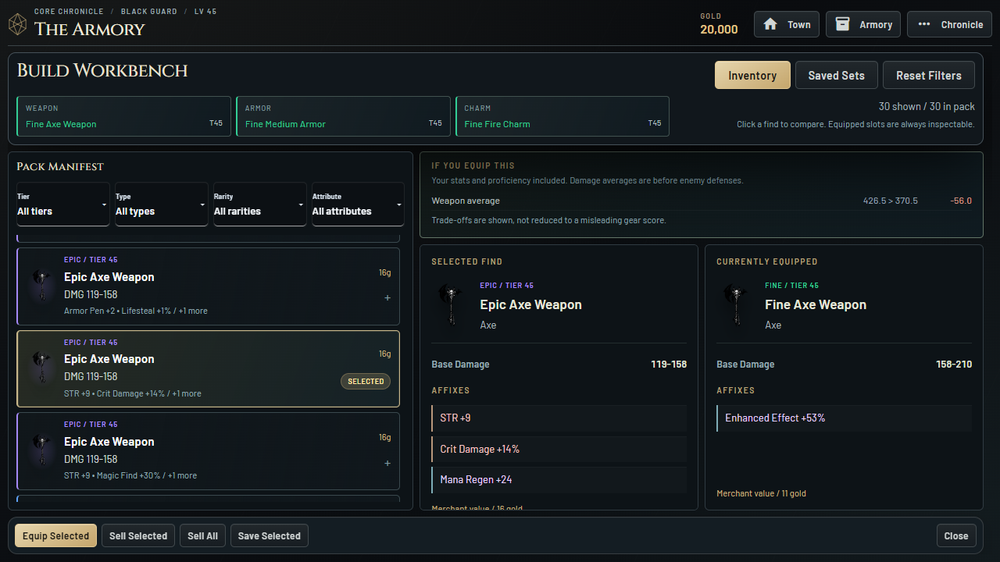
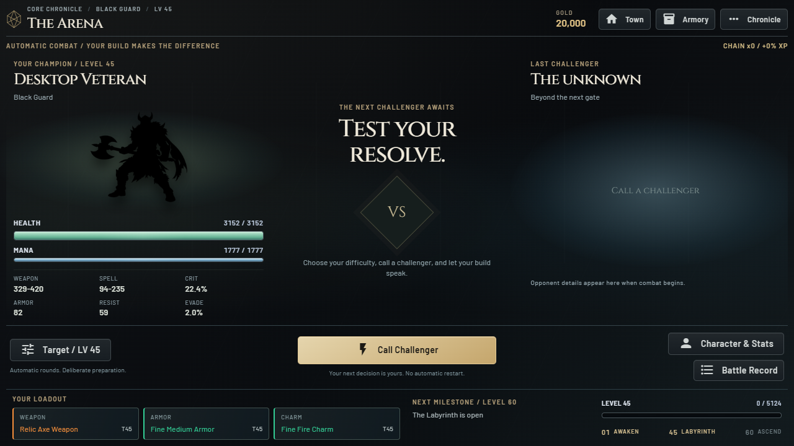
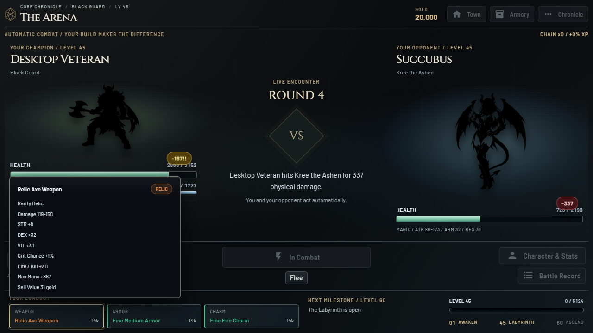

# Chronicle and Equipment Workspaces 0.7.0

## Player Experience

- Three complete save cards replace the overflowing title/sidebar slot list.
  Each has its own hero, progress facts, expedition status and visible Open button.
  Empty slots offer a new chronicle without hiding the other save choices.
- Item rows prioritize icon, rarity/tier, name, base profile and affix preview.
  Additional affixes are counted rather than silently implied absent.
- Full selected/equipped sheets use readable base-stat pairs and flat affix rows,
  not oversized pills. Comparison still uses real character recalculation and
  proficiency, with no fabricated upgrade score or changes to equip rules.
- Saved Sets is a protected collection with the same inspector as the pack.
  Empty state, selection and save/restore/equip actions are explicit.
- The inventory's grid now constrains its pane to its actual allocated row;
  the header/action bar cannot be displaced by long item sheets. Lists and
  details scroll internally. Existing filter and scroll-memory behavior remains.
- Arena restores weapon/spell damage, crit, armor, resistance and evasion in a
  compact readout beneath the resources, without returning to a large spreadsheet.
- Equipped slots support pointer and keyboard inspection during automatic combat.
  One delegated, client-only portal sits outside refreshing combat DOM. It updates
  its anchor without replacing the open tooltip. Escape/focus loss closes it.
  Hover does not open inventory, equip items or send a server request.

## Safety Boundaries

This is presentation-only work on `codex/steam-experience-redesign`. Combat, loot,
save format, item identity and transaction rules are unchanged. No new polling or
combat timing loop is added. Save-card previews read scalar summary fields without
deserializing full inventories or writing saves. Existing safe item actions remain
the only path for save/restore/equip.

The previous source is tagged `steam-reimagined-v0.6.0` at `e2ced9f`. Its complete
Windows executable folder is in `.build-backups/reimagined-0.6.0-e2ced9f/PrismQuest`.
Web/main and both preserved Steam edition folders are unchanged.

## Checks

Automated checks cover summary immutability, escaped/read-only equipment markup,
item conservation across actual UI save/restore/equip, stable pointer/keyboard
inspection through combat refreshes, empty protected collections and bounded
inventory panes at 1280x720, 960x600, 1920x1080 and scaled 800x500.

The original new-player and seeded Labyrinth regression drivers also cover the
redesigned save selector. These are short automated checks, not a full manual
progression or extended native playtest. Steam release gates remain outstanding.

The completed 0.7.0 Windows build passed dependency validation, Ruff and all 165
regression tests. Packaged checks passed for item conservation, non-snapping list
selection, empty/occupied protected collections, mouse/keyboard equipment hovers
remaining open through active rounds, the first Rare drop/equip/fight journey,
five-member Labyrinth movement/tank/inventory, and the 11-buffer audio suite.
Final packaged drivers reported no JavaScript errors or external requests. Hidden
native WebView2 launch and package-integrity verification also passed.

Disposable evidence: `.local-test/equipment-packaged-report`,
`.local-test/equipment-journey-report-02`, `.local-test/equipment-lab-report`,
`.local-test/equipment-audio-report`, `.local-test/equipment-native-01`.
Build log: `.local-test/equipment-build.log`.

