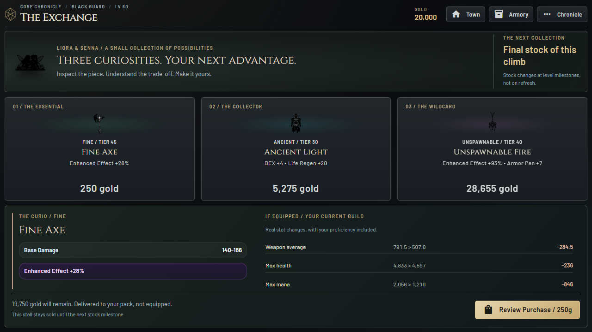
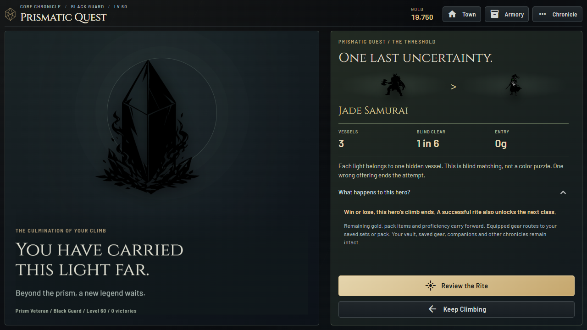
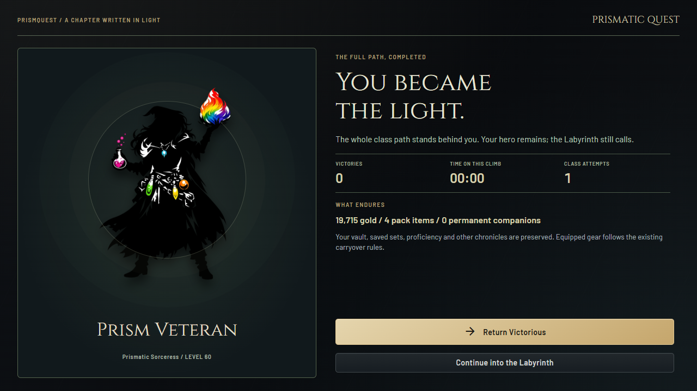

# The Exchange and the Prism / 0.12.0

## A Considered Purchase

Three fixed stalls present the existing Essential, Collector and Wildcard
offers. Type edges, quiet rarity shading, an illustrated item and a clear price
let the player scan the collection. Click to lock inspection; hovering another
piece does not replace the comparison. The lower sheet gives full affixes,
base stats, real equipment deltas and class/level restrictions. There is no
invented power score or promise that rarer means better.

Review Purchase opens inline confirmation. Confirmation revalidates the exact
offer, item fingerprint, price, stock and wallet, resolves the fresh offer index,
then delegates to the original atomic purchase. The item enters the pack, never
auto-equips. A quiet receipt confirms the payment and opens that exact item if
still owned. The receipt snapshot is presentation only, not another award.

All three generation tables, prices and level-based restock rules are unchanged.
Long item sheets scroll internally; purchase actions remain visible.

## The End of a Climb

The threshold honors the current hero before asking for commitment. It names
the next class or final victory, entry fee, vessel count, actual factorial blind
clear odds and consequences. Review is free; Enter pays the original fee once.
The explanation does not imply a solvable color puzzle: colors are cosmetic,
pairings are hidden, and one wrong offering ends the attempt.

In the chamber, choose a light and a vessel, or drag a light. Native keyboard
buttons support Enter/Space; Left/Right moves focus within a row. Bound slots
stay in place so remaining choices do not shift. Judgment temporarily locks
input/navigation. Step Away explicitly confirms an unfinished retreat; the
entry fee is not refunded. Main navigation cannot bypass that confirmation.

The original solver controls its 1.05-second judgment and subsequent original
resolution timing. Local finite opacity/transform effects accompany those
phases; no additional gameplay wait, server animation loop or polling was added.
The client signal contains phase, submitted keys and actual matched count, not
the hidden solution or correctness before the verdict.

After a durable outcome, a full-page aftermath honors the hero, records climb
victories/time/attempts, names the class unlock where applicable and explains
what carries forward. Normal success and failure retire the current hero under
the existing rules. Final-class success preserves the hero and offers Town or
Labyrinth instead of resetting chronicles. No extra Claim transaction or automatic
next-character creation is involved.

Entry and settlement wrap the synchronous original progression in a single disk
commit. A failed write restores hero, gold, gear, saved sets, other chronicles,
ledger and progression in memory. An unsaved outcome can be retried in-session
without recording another attempt. This does not introduce a new cross-restart
checkpoint for unfinished rites or their presentation receipts.

Judgment callbacks outlive their original buttons, so refreshes use the stable
page context. This avoids scheduling timers under deleted UI containers. Neither
the shop nor the chamber is rebuilt by passive-regeneration ticks while browsing.

## A Restrained Score

Eight original procedural mono cues/loops are bundled under `audio/v2` with
durations, hashes and measured peak/RMS metadata. The chamber's seamless, quiet
bed replaces most of the ordinary ambience while present. Threshold, judgment,
binding, fracture, ascension, final completion and purchase have distinct cues.
New buffers load lazily, not at the title screen. No recordings, remote services
or external requests are required.

Existing music/effects volume, reward mute, master mute and unfocused muting
remain authoritative. Cues deduplicate across renders. Late loading cannot play
an obsolete phase, voices are bounded, and leaving fades the chapter layer.
Reduced motion cancels decorative work without changing outcomes. There is no
strobe, infinite animation or per-frame server traffic.

## Verification and Rollback

`tests/test_chapters.py` exercises explicit/stale purchases, exact ownership,
disk rollback, entry once, invalid choices, all 3/4/5/6-slot permutations,
concurrent clicks, original success/failure/final rules, item conservation,
other-chronicle preservation and retrying a failed outcome save. Audio tests
validate the original local assets, hashes, level bounds and loop seams.

`tools/desktop_chapters_smoke.py` exercises real purchases and quest settlement,
screens from 800x500 through 1920x1080, fixed action visibility, local audio,
browser errors, external requests and saved item/ledger conservation.
`tools/run_chapter_qa.py` is a source-only fixture observer: it privately records
the actual randomly generated solution in a disposable directory so success and
failure can both be exercised. It is not imported or packaged by the game; no
test oracle, forced outcome, public endpoint or answer is shipped.

Release evidence:

- All 257 regression tests, dependency validation and desktop lint passed.
- Source browser acceptance passed normal success (26 captures), failure (24),
  and six-light final victory (29), preserving every item and other chronicle.
- Packaged browser acceptance passed an actual blind success and, on the final
  audio-continuity build, an actual blind failure. No oracle was available to it.
- The final executable also passed two real Crucible crafts, conservation and
  reduced-motion acceptance (13 captures).
- Browser checks reported no JavaScript errors or non-loopback requests.
  A separate presentation harness passed cue deduplication, mute/no backlog,
  reduced motion and cancellation of an obsolete late-loaded cue.
- Hidden native WebView2 launch passed with 1084x681 content and no page overflow.
- Post-gameplay integrity verification checked 996 files with no changed or
  unexpected entries; the executable's own verification also exited successfully.

This is not a clean-machine install test, accessibility certification or long
native soak. Existing third-party licensing/asset-rights and Steam release gates
are not waived by these local checks.

The full previous 0.11.0 executable folder remains under
`.build-backups/reimagined-0.11.0-2e0613d/PrismQuest`, with source rollback tag
`steam-reimagined-v0.11.0`. Normal player saves, preserved editions and the web
main branch are untouched. Steam service release gates remain unchanged.
