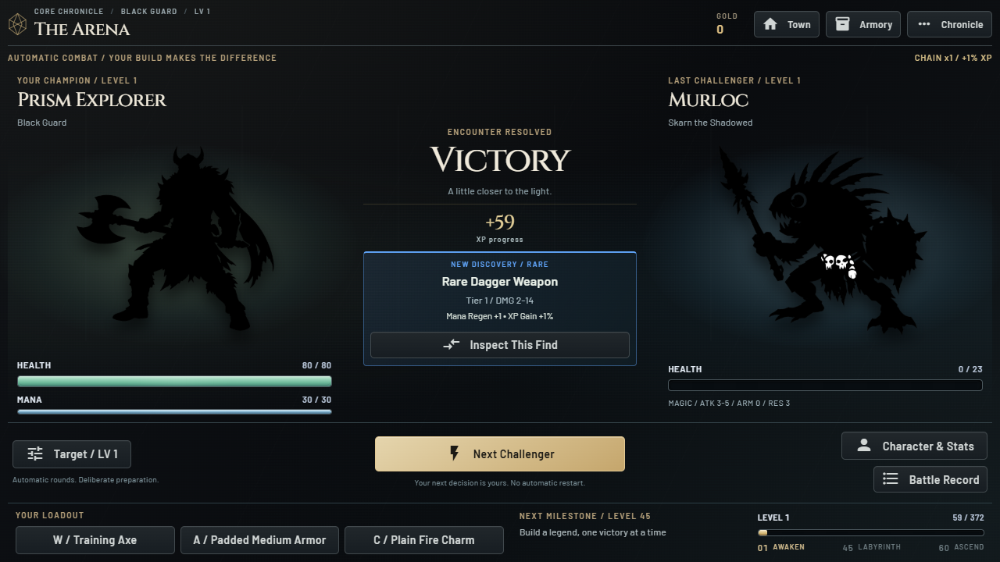
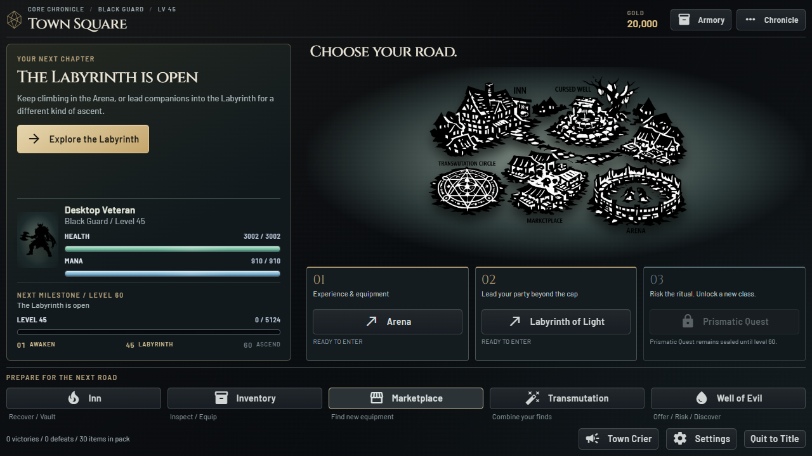
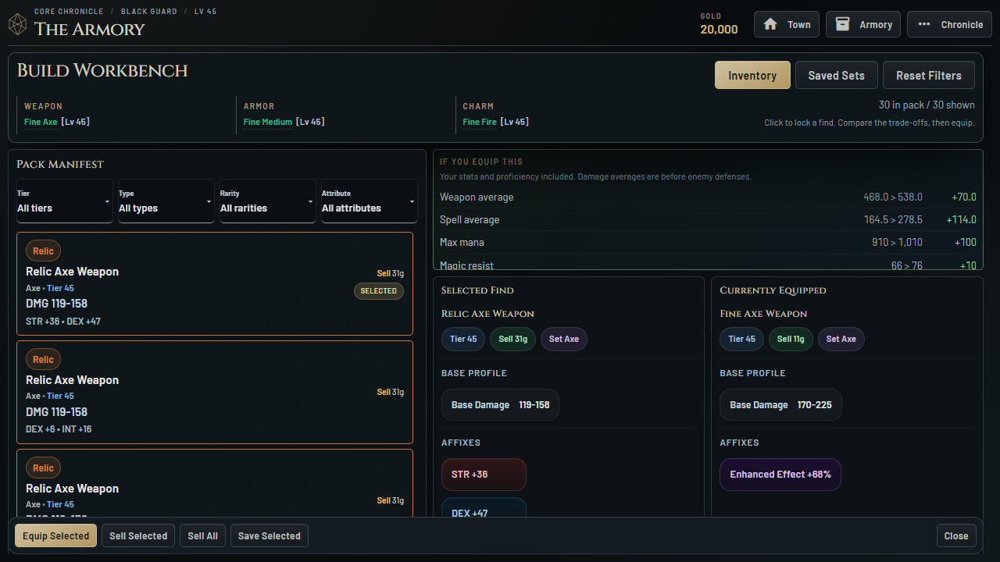
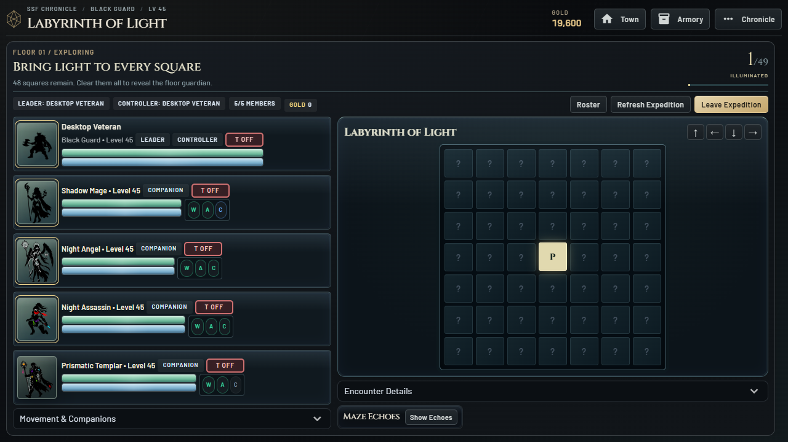

# PrismQuest Reimagined: Experience Design 0.5

## Preserve the Previous Iteration

Nocturne 0.4.0 is preserved in the sibling SteamEditionVisual folder at af00de2,
tag steam-nocturne-v0.4.0. The original 0.3.0 edition remains in SteamEdition.
This iteration is isolated in SteamEditionReimagined on
codex/steam-experience-redesign, with its own default save profile.

## Design Intent

The old interface exposes the implementation: a large character spreadsheet,
an equally large enemy spreadsheet, numerous similarly styled buttons, and
rewards relegated to a corner. The player must infer the goal and decide which
numbers matter. Better surfaces alone cannot resolve that hierarchy.

Rebuild the information architecture around five questions:

1. What am I trying to accomplish? Give progression a persistent destination.
2. What is happening right now? Put combatants, resources and live events first.
3. What did I earn? Use a dedicated, truthful result phase, not only a log line.
4. Does this item help my build? Show actual recalculated equipment deltas.
5. What should I do next? Offer contextual routes without taking control away.

## Implementation Boundaries

Combat rolls, item ownership, drop rates, progression rules, saves, permanent
companions, and transactions remain authoritative and unchanged. Presentation
models observe the existing lifecycle. Receipts never award rewards or move
items. Item review uses object identity, never equality of item rolls. Existing
safe equipment actions remain the only mutation path. No new polling is added.

The old style remains the visual foundation, not the screen layout. This pass
replaces the town and Arena composition, introduces a global navigation model,
adds meaningful equipment comparison, and clarifies expedition state.

## What Changed for the Player

- Arena is a shared battlefield, not a pair of stat sheets. Health and mana
  belong to the combatants; a central round/event focus explains active combat.
- A distinct victory state shows actual XP progress, level gains and the new
  drop. Inspect This Find selects that exact owned object in the workbench.
  Equal item rolls are not treated as interchangeable. A sold/equipped/stale
  snapshot cannot mutate or select a different item.
- Rarity accents and finite light reveals celebrate discoveries once, without
  replaying every refresh. Common finds have no item light sweep. Reduced motion
  and the existing loot-animation preference suppress the effects.
- Low health, unused stat points, Labyrinth eligibility and ascension readiness
  inform the town's recommended next step. Other routes remain available.
- The workbench locks selection on click and shows recalculated stat deltas,
  including proficiency and damage averages. Mixed trade-offs stay mixed;
  there is no fabricated overall upgrade score.
- Core allocation, build totals and proficiency have a dedicated Character
  workspace. Routine navigation no longer competes with combat on multiple rows.
- The expedition overview states the current objective and resolved tile count,
  while preserving the existing map, party, companion and combat systems.
- Optional scene explanations are still accessible under Chronicle > Tutorial,
  but no longer block every first service visit. The introductory journey,
  first Rare reward, first-death recovery and level-5 community prompts remain.

## Launch and Roll Back

New executable: `SteamEditionReimagined/dist/PrismQuest/PrismQuest.exe`.
Keep the complete executable directory, including `_internal`.
Default profile: `%LOCALAPPDATA%/PrismQuest/SteamEditionReimagined`.
Nocturne uses `SteamEditionVisual`; the original edition uses `SteamEdition`.
Progress is not automatically shared or imported between these editions.

To roll back, launch the old executable in its original folder. No Git reset,
save replacement or uninstall is required. Main/the hosted game is unchanged.

## Verification: 2026-10-29

- 151 regression tests passed, including actual payout observation after the
  combat simulator swaps in its copied player, exact-item review, level rollover,
  nonmutating stat comparison, incompatibility explanations and slot isolation.
- Ruff, compilation and dependency checks passed. All 154 original assets are
  unchanged. AST comparison confirms the 711 non-renderer game definitions are
  unchanged; new feedback observers and read-only models live in separate modules.
- Final packaged fresh-player run passed: character creation, first Rare payout,
  direct find inspection, an equipment change, another real fight, manual help,
  saved-set access, Character, records, glossary, Inn/vault, Marketplace,
  transmutation, Well and settings. No external requests or browser errors.
- Final packaged seeded run passed: 30-item workbench, click-locked inspection
  across hover, stable Close control, vault, five-member Labyrinth, green pressed
  tank state, inventory return without leaving the expedition, and arrow movement.
- Title, Arena victory and town fit 1280x720, 1366x768, 1920x1080, 960x600,
  2560x1080 and scaled 800x500 without document overflow. Workbench and Labyrinth
  checks include 960x600 through Full HD. Long item/detail panes scroll internally.
- Final packaged native WebView2 launch passed with a 1084x681 client viewport
  and a 681px document height. Final package-integrity verification passed.
- A short 20-second packaged-candidate Labyrinth sample received 65,876 bytes
  of local WebSocket payload, used 1.843s renderer task time and 0.069s layout
  time, with about 9.70 MB JS heap at the end. Title idle received no server
  frames in its 20-second sample. No errors or external requests were observed.
  These are short headless-Chrome samples, not total CPU/GPU measurements or
  a controlled speedup claim. No new polling or combat pacing changes were added.

Detailed disposable artifacts are under `.local-test/experience-release-core`,
`.local-test/experience-release-advanced` and `.local-test/packaged-experience-performance`.
The release build log is `.local-test/experience-build-release.log`.

Long-session native playtesting, balance/progression playtesting, controller
support, clean-machine installation, Steamworks configuration and the previously
documented release gates remain outstanding. This is not a Steam-ready release.

