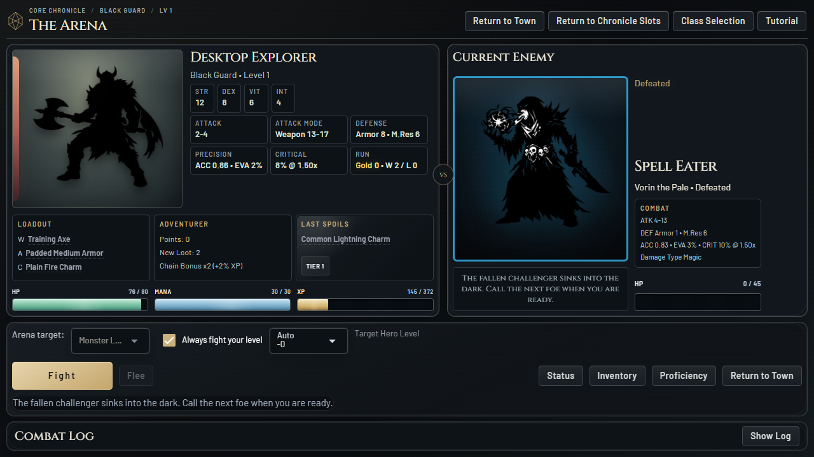
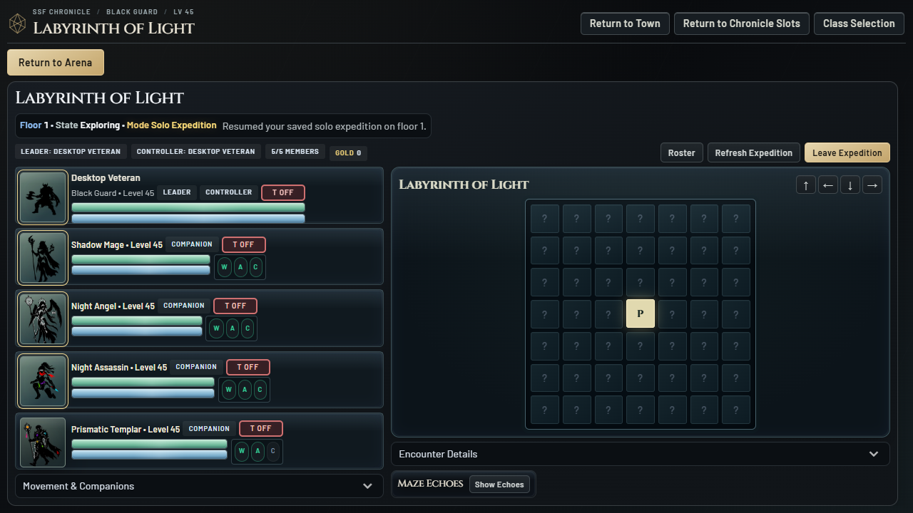

# Nocturne Visual Edition 0.4.0

## Preserve and Return

The previous standalone edition is preserved at commit
`eeaa9387f42d773271f6c669b51502ce334537a4`, tag `steam-alpha-v0.3.0`, on
`codex/steam-standalone` in the sibling `SteamEdition` folder. Its existing
0.3.0 executable is unchanged. This edition is a separate Git worktree/folder
on `codex/steam-visual-overhaul`; the hosted web game is not changed or deployed.

Launch this edition from `SteamEditionVisual/dist/PrismQuest/PrismQuest.exe`.
Launch the previous edition from `SteamEdition/dist/PrismQuest/PrismQuest.exe`
to return to it. Keep each complete executable folder, including `_internal`.
No Git commands or file replacement are needed to switch between these builds.

Default saves are separate:

- Previous edition: `%LOCALAPPDATA%/PrismQuest/SteamEdition`.
- Visual edition: `%LOCALAPPDATA%/PrismQuest/SteamEditionVisual`.

The save format is unchanged. A fresh default profile in the visual edition
does not mean the old characters have been lost. Do not point both editions
at the same profile or manually copy files while either is running. This pass
does not migrate, overwrite, or automatically import existing player saves.

## Art Direction

An illuminated dark-fantasy chronicle: ink-black and blue-black surfaces, warm
ivory text, precise silver rules, antique-gold primary controls, and restrained
prismatic accents. Original silhouettes and scene illustrations remain intact.

- Title: contained artwork, geometric light rings, an editorial main menu,
  and clear offline/local identity.
- Chronicles: three distinct volume cards, with separate Core, SSF, and HC colors.
- Character selection: quiet portrait plates and accessible entry controls;
  the obsolete overlaid selection log no longer intercepts clicks.
- Town: stronger route hierarchy and a lit map plate to improve black-label
  contrast without editing the underlying artwork.
- Arena: opposed portrait plates, readable numeric telemetry, a compact VS
  marker, distinct primary Fight control, and consistent panel edges.
- Labyrinth: a prism observatory palette, legible tile states, compact party
  cards, explicit red/green tank states, and readiness/healing treatments.
- Items and services: shared inventory, comparison, tooltip, dialog, input,
  and button language, with rarity colors and item reveal mechanics preserved.

Cinzel and Barlow are bundled locally from the official Google Fonts repository.
Their SIL Open Font License texts are included beside the font files and in
the generated third-party notices. No remote font CDN is used.

## Stability Boundaries

This is a presentation fork, not an economy, item, balance, AI, or combat rewrite.
Combat timing, HP/mana/XP animation data, loot reveals, companion progression,
save format, and item transaction code remain unchanged.

The skin uses CSS instead of the legacy button-painting MutationObserver.
Quasar's important color layer is overridden explicitly, avoiding repainting
every button during combat updates. Decorative menu arrivals only run on title
and chronicle screens, not on refreshable Arena/Labyrinth combat containers.
There are no new polling timers, per-frame backend calls, remote resources,
GPU backdrop blurs, or additional gameplay WebSocket messages.

Window-fit layout and bounded internal scrolling are retained. Small-window
resize scaling, fullscreen, system reduced-motion preferences, and the in-game
reduced-motion setting remain supported. The original art files are unchanged.

## Verification

Validated on Windows on 2026-10-28, using disposable profiles only:

- 140 regression tests passed. Ruff and dependency checks passed.
- Python AST comparison against `eeaa938`: all 711 non-renderer top-level
  gameplay definitions are unchanged. The game-file renderer diff is presentation
  only; the global legacy button painter also skips this CSS-skinned edition.
- All 154 original asset files are unchanged in Git.
- Source and packaged title, tutorial, Arena, and town fit 1280x720, 1366x768,
  1920x1080, 960x600, 2560x1080, and the scaled 800x500 fallback without page overflow.
- Packaged service screens, inventory, vault, saved sets, and five-member
  Labyrinth passed at 1280x720, 960x600, and 1920x1080. Primary controls remain
  reachable; inventory hover did not recreate the dialog's Close control.
- Tank toggle has its expected pressed state and green outline. Labyrinth
  keyboard movement and inventory access passed. Tutorial and additional Arena
  fights completed, including the guaranteed introductory Rare item.
- Local fonts loaded successfully with a one-year cache header. Reduced-motion
  emulation disabled the menu arrival animation. No attempted external requests
  or browser errors were observed in the automated interaction runs.
- Packaged native WebView2 launch exited successfully: 1084x681 client area,
  681px document height, title artwork and fullscreen control present.
- Packaged SHA-256 integrity verification passed; all five new font/license
  files are in the 961-file build inventory. Font notices are also copied to the
  distributable's third-party notices directory.

Short headless-Chrome measurements against the actual executables, 20 seconds
per sample:

| Measurement | Preserved 0.3.0 | Nocturne 0.4.0 |
| --- | ---: | ---: |
| Title renderer task time | 0.0035s | 0.0032s |
| Five-member Lab renderer task time | 2.403s | 2.466s |
| Lab renderer layout time | 0.109s | 0.092s |
| Lab received local-WebSocket payload | 64,100 bytes | 62,706 bytes |
| Lab JS heap at sample end | 9.62 MB | 9.62 MB |

These samples show broadly similar short-run rendering cost, not a statistically
controlled benchmark or a claim of lower total CPU. Battles can finish during
the sample; figures exclude native-process/GPU usage and framing overhead.
Detailed ignored reports are in `.local-test/nocturne-performance` and
`.local-test/baseline-performance`. Build output is recorded in
`.local-test/nocturne-build.log`.

Automated checks do not replace a longer native session or clean-machine QA.
Steamworks IDs, signing, store/asset rights approval, controller support, and the
other documented release gates remain outstanding.
