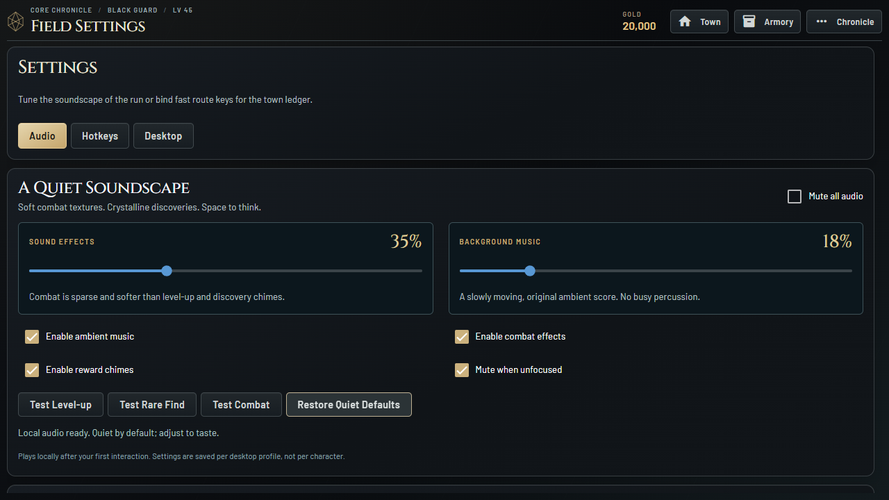

# Quiet Soundscape 0.6.0

## Direction

Low, airy minor/add9 ambient chords leave room for the silhouette artwork and
decision-making. A quiet undertone fades in during combat, rather than restarting
the music. Muted impacts and soft spell textures are deliberately less prominent
than the warm level-up and item-find chimes. There are no generic button clicks,
voice lines, jump-scare effects or sounds for Common drops.

Effects default to 35%, music to 18%. Settings > Audio provides independent volume
sliders, master mute, music/combat/reward toggles, focus muting and exclusive preview
buttons. Music ducks beneath rewards. A simultaneous level-up and item drop are
staggered rather than slammed together. Higher-rarity finds use a richer chime.

## Implementation

- Original deterministic standard-library synthesis: `tools/generate_audio.py`.
- Eleven versioned mono WAV assets; no third-party recordings or sample libraries.
- One Web Audio context, two loop sources, at most four tracked effect voices.
- Decode once after a user gesture; local cacheable URLs, no streaming services.
- Combat cues are rate-limited to one per 750 ms, with fewer overlapping effects.
- Event metadata travels on existing renders; Labyrinth uses its existing partial
  combat payload. No new game timers, polling, WebSocket loop or loot RNG calls.
- Profile changes and repeated renders do not replay old rewards. Unfocused
  playback fades/suspends by default and discards delayed one-shots.
- Preferences are validated and atomically saved to independent `audio.json`;
  slider writes are coalesced. Character saves and item ownership are untouched.

`steam_client/static/audio/AUDIO-SOURCES.md` documents origin and reproducibility.
The 12-second `soundscape-preview.wav` is a demonstration mix, not a runtime asset.

## Verification

Automated tests cover preference validation, atomic failure safety, read-only
signals, hashes/PCM format, headroom, silence bias, loop seams and smoothed effect
boundaries. Browser tests exercise actual audio decoding, autoplay locking,
volume/mute persistence, preview categories, focus suspension, deduplication,
level/drop sequencing and existing Labyrinth partial updates. UI checks include
960x600, 1280x720 and 1920x1080 without global overflow or external requests.

The completed 0.6.0 Windows candidate passed:

- Dependency validation, Ruff, 163 regression tests and package hash verification.
- Packaged audio UI/harness: all 11 buffers decoded, zero failed assets, saved
  mute/volume survived reload, focus suspension and quiet resume worked, repeated
  metadata/partial updates did not replay effects, and disabled categories stayed
  silent. No page errors or external requests were observed.
- A real new-player Arena fight, guaranteed Rare chime exactly once through six
  viewport changes, equipment inspection/equip and another fight.
- Seeded workbench selection, vault, five-member Labyrinth, tank toggle, inventory
  return and movement; layouts through ultrawide and scaled 800x500.
- Hidden native WebView2 launch and clean shutdown.
- A short 20-second headless Labyrinth sample: 1.998 seconds renderer task time,
  0.078 seconds layout time, 66,464 received local WebSocket payload bytes and
  approximately 9.82 MB JS heap. Title idle received zero server frames over its
  20 seconds. These are not whole-process/audio-thread CPU measurements, a
  controlled speedup comparison or an extended soak test.

Disposable evidence is under `.local-test/audio-packaged-report`,
`.local-test/audio-journey-report`, `.local-test/audio-lab-report`,
`.local-test/audio-performance-report` and `.local-test/audio-native-01`.
The release build log is `.local-test/audio-build.log`.

Headless tests do not establish how the mix sounds through physical speakers or
headphones. A subjective listening pass, real audio-device switching, extended
native soak and clean-machine QA remain release gates. Volumes are adjustable
because perceived loudness and player preferences vary.

## Rollback

This is isolated to `codex/steam-experience-redesign`; web/main is not changed.
The previous source is tagged `steam-reimagined-v0.5.0` at `c11fc95` and its complete
Windows folder is preserved in `.build-backups/reimagined-0.5.0-c11fc95/PrismQuest`.
The original SteamEdition and Nocturne folders/executables remain untouched.

