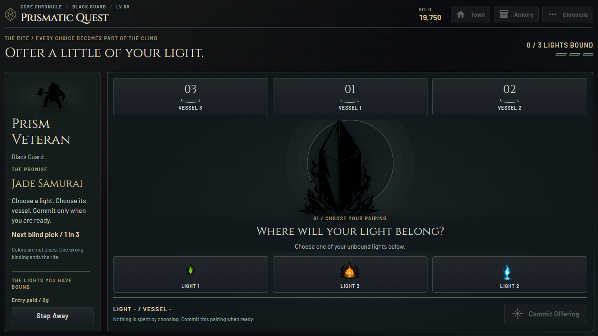
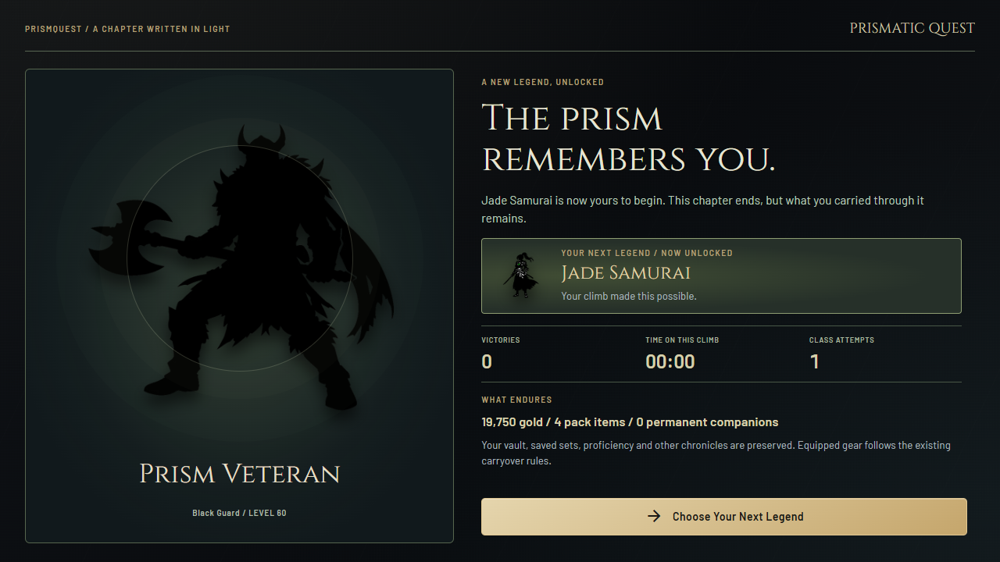

# Stable Views and a Deliberate Rite / 0.13.0

## Freeze Paths Addressed

The old throttle used a NiceGUI timer created in the requesting element's slot.
A replaced panel could remove that timer while the shared `pending` flag stayed
set. All later requests would then be ignored. Separately, this pinned NiceGUI
version returns an asynchronous AwaitableResponse from `refresh()`. Treating it
as synchronous meant the throttle did not observe actual completion or errors.

Desktop scenes now use an event-driven page-owned queue with no polling. It
coalesces updates, awaits the actual render, serializes reentrant requests,
invalidates forced-out stale callbacks and clears pending state on all error
paths. Deleted clients cancel their own queued work. Older action callbacks
route refresh requests to the current page of the same shared desktop session,
including after a browser/native-page reload. A persistent Retry View control
outside the refreshed scene appears after render failure. It redraws; it never
resets a fight, changes gear or grants/refunds an item.

Errors are logged with traceback. This handles identified view-queue deadlocks,
not every conceivable hardware/OS/render-driver failure. A deterministic scene
bug still needs its underlying fix; Retry View is recovery, not a claim that an
invalid view can always be drawn successfully.

## The Offering Loop

Choosing a light or a vessel now aims a pairing. Nothing resolves until the
explicit Commit Offering action. A selected frame, named pair and disabled-button
explanation distinguish choosing from committing. Dragging aims rather than risking
an accidental immediate submission. Bound slots remain fixed with visible checks;
a real binding ledger and progress marks record how far the player has come.

The normal reveal has a 2.7-second listening phase and 1.1-second answer. A last
correct binding adds 1.4 seconds for the seal to open before settlement/aftermath.
Finite client-local ring, prism, progress-track and bloom effects accompany those
phases without per-frame WebSocket traffic. Success reveals the newly unlocked
class in a distinct illustrated card. Final completion retains the current hero.
Failure honors the climb and explains carryover rather than suggesting an item
claim or a reward that does not exist.

Quick Reveal, or Escape while waiting, skips the remaining presentation waits for
that committed offering. It cannot change its pair, result, fee or award. Reduced
motion suppresses decoration; controls and truthful static status remain visible.
Primary actions and retreat controls are pinned outside long explanatory panels.

The authoritative hidden permutation, entry costs, tier-dependent slot counts,
factorial full-clear odds, class progression and original finish/carryover function
are unchanged. Colors are not hints. The displayed next-pick odds are 1 in the
number of remaining vessels, not an invented pity bonus.

The desktop controller now owns its bounded offering phases instead of temporarily
replacing the game's finish method across asynchronous waits. A committed pair is
captured once, with no new RNG during reveal. Cancellation or an unexpected error
keeps that pair recoverable in-session; it cannot be replaced by another choice.
Applied bindings are idempotent on continuation. A display callback cannot abort
an offering's rules. Settlement and creation of its read-only receipt precede a
single atomic disk commit, so a receipt failure cannot commit once then double
the ledger on retry. Original save-failure rollback tests remain in force.

This does not add persistence of unfinished rites across process exit. Page reload
and in-session continuation are tested separately from a full game restart.

## Sound and Performance

Four quiet original cues under `audio/v3` accompany the longer listening,
unsealing, ascension and final completion. Earlier versioned audio files are not
overwritten, preserving their long cache lifetime. New sounds load lazily and use
the existing volume, music/reward switches, master mute and focus policy.
No external service, asset dependency, render polling or combat pacing change was
introduced. The 250ms scene update cap remains; local effects are finite and cancel
on focus loss/reduced motion. Core Arena/Labyrinth combat and item systems are not
rebalanced by this update.

## Verification and Rollback

New unit regressions cover scheduling/render errors, stale callbacks, deleted
pages, burst coalescing, asynchronous render completion, reentrancy, explicit
commitment, cancellation/continuation, broken display callbacks, Quick Reveal and
receipt-before-commit safety. Existing ownership/progression and original audio
hash/seam tests remain. `tools/refresh_recovery_smoke.py` is a standalone disposable
browser fixture that deliberately replaces its submitting panel mid-callback and
injects a render failure; it is not packaged or exposed by the game.

`tools/desktop_chapters_smoke.py` verifies real purchases and rites, four viewport
sizes, pinned actions, in-judgment reload, conservation of every item and other
chronicle, one ledger entry, Quick Reveal, reduced motion and local audio. The
source-only oracle remains private test tooling, never a shipped answer endpoint.

Completed checks:

- All 272 unit/regression tests, dependency validation and desktop lint passed.
- The standalone browser stress fixture completed five burst replacements,
  retained its counter through an intentional render failure and recovered via
  Retry View. No helper server was left running.
- Source acceptance passed success (26 viewport captures), refusal (24), and
  six-light final victory (29), including in-judgment reload, Quick Reveal and
  reduced motion. Item counts, alternate chronicles and one-attempt settlement
  were checked independently of presentation.
- The final packaged game completed a real blind successful rite, including
  explicit commitment and in-judgment page reload (26 captures).
- Packaged multi-scene checks passed inventory, saved sets, vault, services,
  a five-member Labyrinth, tank toggling, inventory return and keyboard movement.
- Packaged Arena battles/retained-drop inspection and two real Crucible crafts
  passed, with no browser JavaScript errors or external requests. Normal test-game
  logs were empty; the synthetic renderer-failure fixture has its expected error.
- Native WebView2 launch passed with a 1084x681 viewport and no page overflow.
  Post-gameplay package verification checked 1002 files, with no changed or
  unexpected files; the executable's own verification also passed.

These are targeted regression and smoke checks, not a multi-hour native soak or
a claim that every possible freeze is eliminated. Existing Steam/platform,
clean-machine and rights/licensing release gates remain open.

The full 0.12.0 build is in
`.build-backups/reimagined-0.12.0-455fe01/PrismQuest`, with source bookmark
`steam-reimagined-v0.12.0`. Normal player profiles, main/web and both preserved
Steam editions are untouched. This remains an alpha, not a certified Steam release.
